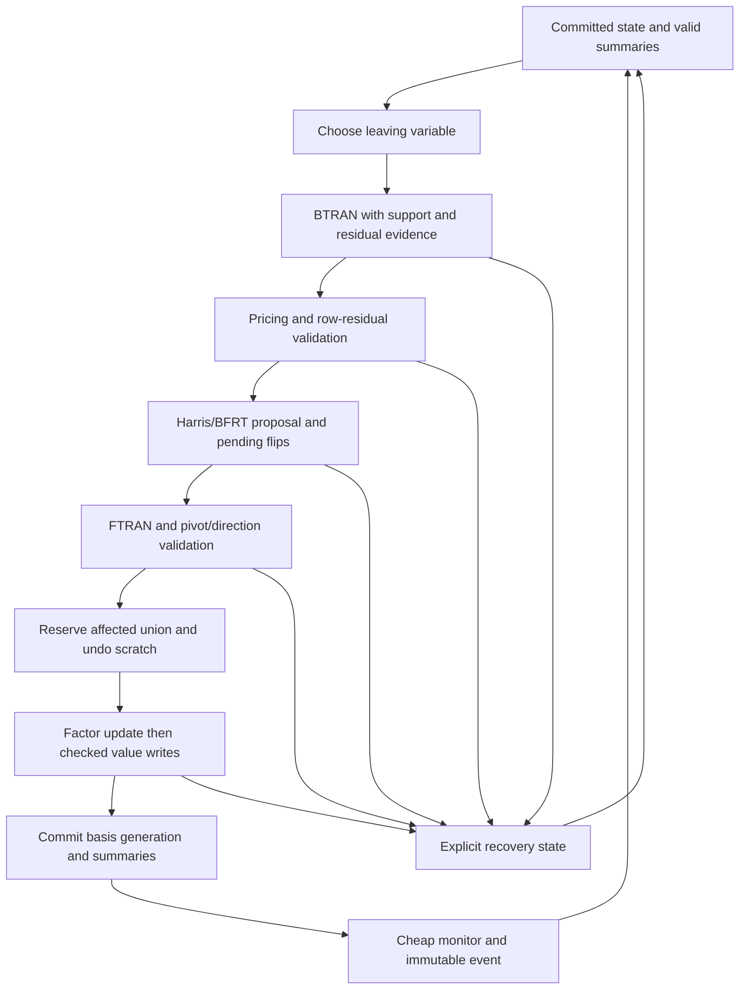

# Experimental coupled dual engine

Date: 2026-10-31. Status: design proposal, not an implemented or validated algorithm.
Branch: `codex/dual-step-experiment`.
Base: current master `9940bdabe149e922afa60b5364227a7e7393bc75`.

## Intent and agreement

The user approved a new experimental branch to redesign the whole dual step together with monitoring and numerical recovery. The purpose is a material reduction in the cost of obtaining a verified solution, rather than another isolated kernel saving. Existing arithmetic order, pivot trajectory, repair sequence and internal event counts are not compatibility requirements of this experiment. A modest allocation increase may be acceptable for credible total runtime improvement.

Correctness remains defined on the original problem and requested tolerances. No coefficient dropping, tolerance relaxation, false terminal status, certificate transfer from a different model, or unreported precision escalation is permitted. An uncertain numerical result must remain uncertain. Changing when/how a check runs requires an equivalent conservative guarantee or an explicit unproved obligation; periodic checking alone cannot replace a correctness-critical check.

This proposal does not authorize production integration or numerical runs. This task creates only an isolated branch and design documents. No Julia, package installation, candidate implementation, new LP, numerical measurement or CI change is part of this deliverable. Old frozen artifacts and rejected routes are evidence, not scripts to rerun. The previous diagnostic checkout is retained intact.

## Approaches

1. **Coupled engine with private phase state, proposed steps, maintained invariants and an explicit recovery state machine.** Recommended architecture, following the whole-step direction accepted in the conversation. It allows removal of repeated scans and state copies across function boundaries, while keeping the current solver as a reference and phase-boundary compatibility path. Ownership and recovery must be designed together.
2. **Continue modifying the legacy controller in place.** Lower initial integration cost, but retains observer exposure, repeated checking and nested retry boundaries that constrained earlier optimizations. Useful source/oracle reuse, not the experimental architecture.
3. **Replace presolve, factor managers and the entire solver simultaneously.** Potentially wider scope, but obscures which work was removed and makes numerical failures hard to localize. Defer: this experiment changes the dual engine and its controls, not every subsystem.

The user's choice is the whole-step experiment; the detailed private-state architecture below is the author's proposal for approval, not an already approved implementation plan.

## Current source anchors and lessons

The base source is the authority for current behavior:

- `src/dual_simplex.jl::_dual_optimize!`: entry finite checks, dual/primal feasibility, iteration dispatch and post-step monitors.
- `_dual_iteration_unchecked!`: unit BTRAN, pricing, row residual/correction, pricing-weight decisions, ratio test, FTRAN and pivot validation, flips, numeric updates, factor update and publication; several branches restart the operation.
- `_dual_row_residual_ratio` and `_dual_direction_residual_ok!`: residual and componentwise scale criteria that must be matched or conservatively dominated.
- `src/dual_ratio.jl::propose_dual_step!` / `_validate_dual_ratio_candidate!`: proposals with borrowed scratch, full-row scans and candidate validation. Eligibility and infeasibility are distinct decisions.
- `src/simplex_pivot.jl::_retry_simplex_step!`, `_transactional_simplex_step!`, `_copy_pivot_state!`: staged values, shared factor ownership, retries and pending events. Discard is not whole-factor rollback.
- `src/simplex_recovery.jl`: refinement, checkpoint restoration and transactional Devex fallback; repaired state needs revalidation.
- `src/hypersparse_pipeline*.jl` and `src/sparse_pricing.jl`: indexed buffers, invalidation, support rebuilding, sparse/dense routing and an immutable-matrix row index already exist. Their costs cannot be presumed absent.
- `src/solver.jl` and original-model certification in `dual_simplex.jl`: restoration, cleanup, retry and final certification remain part of end-to-end cost.

Historical lesson: support metadata and moved checks do not by themselves save work. The latest isolated SS study completed its comparison but all 16 instrumented cases had zero local elimination pivots, with indexes disabled after admission/handoff. It measured the current wrapper/index/fallback behavior, not activated local elimination. This design requires real activation before performance claims and does not reuse that candidate or reopen its gate.

The order-of-magnitude performance gap is user-reported motivation, not a newly controlled cross-solver measurement. No attribution of the whole gap to any one source pattern is established here.

## First experimental scope — author choices

- First implemented engine: `Float64`, ordinary continuous dual simplex, working CSC matrix, initially the existing production PFI backend with native arithmetic. Reuse its public factor interface; no new SS/FT/BG/KLU/HH algorithm or symbolic reuse.
- First correctness and cost comparisons use a fixed Devex policy in both reference and experiment. Separately compare each solver's intended practical policy; a Devex-versus-DSE trajectory change must not be called a kernel saving. Exact DSE support is a later extension with its extra solve/weight-maintenance cost explicit.
- Float32 follows only after the Float64 invariants and recovery paths are qualified; BigFloat and rational types remain on the current engine. There is no generic support-omission claim for mutable scalar owners.
- Existing presolve, auxiliary initialization, primal phase, cleanup and final original-model certificate are reused at explicit handoff boundaries. They may be expensive and remain inside total solve accounting. New phase-initialization or cleanup omission is outside scope.
- An experimental internal entry point and distinct private types dispatch to new code in this branch. No overwritten methods for current concrete production types, no copied full JSimplex module and no default/public solver routing change in the first candidate.
- The caller sees ordinary solver results. Experimental semantic tests may differ from old internal-count or bitwise-trajectory tests; existing production tests remain intact and their incompatibilities are classified rather than weakened.

## Ownership and state

An engine owns its numeric vectors, basis/state maps, proposal scratch, invariant summaries and factor lifecycle for the entire phase. Allocate once, reuse physical capacities, and change logical lengths on reuse. The working model/bounds are immutable for that ownership epoch; cost shifts and bound flips are explicit owned writes. No untracked writable views escape.

Borrow an existing factor only with a proved ownership transfer. Otherwise make one owned factor copy/rebuild at the phase boundary and count its work/memory. Never assume native or extracted factor state rolls back on a failed update. Do not copy an entire workspace or factor per accepted pivot.

Proposed records:

- `DualEngineState`: owned committed basis, numeric values, active pricing mode, generation and phase state.
- `DualStepProposal`: leaving/entering IDs, scalar steps, pending flip IDs, validated solve outputs and generation-bound evidence. Scratch is borrowed only until the next proposal; no retained reference to a mutable old proposal.
- `DualInvariantState`: exact membership/position lists for primal violations and dual-price violations, finite-value provenance and dirty regions; every mutator has an explicit update/invalidation rule.
- `DualRecoveryState`: nonrecursive repair stage, rejected candidates for the current generation, attempts/solves/refactors and common deadline. Rejections expire when their basis/cost/state assumptions change.
- `DualUndoScratch`: first-write old values/IDs and old scalar state for the proposal's affected union. Preallocate capacities; no growing per-solve history. Dense unions may cost O(m+n) and must be reported.

The original workspace retained by legacy callers must not alias engine-owned mutable values. Setup/handoff copies and simultaneous retained factor owners belong in the peak-memory ledger.

## Ordinary step and commit

1. Select from maintained infeasible basic membership, checking current scores. Devex is approximate pricing by design; no promise of the old global-max trajectory. Changes to membership/scoring are accounted at the writes that cause them.
2. Solve the unit BTRAN once on an ordinary successful attempt. Its producer returns output/support provenance; do not rediscover support by scanning the whole result solely to enter another kernel.
3. Price the row and validate `B' * rho = e_leaving`. Reuse arithmetic/evidence only where its error bound is conservative. In particular, accumulating `a_j' * rho` and subtracting the expected basic value afterward need not have the same error as the legacy residual accumulation. If equivalence is not proved, retain the original residual check and count it.
4. Produce a two-pass Harris/BFRT proposal over complete relevant support plus separately handled free/fixed/boxed states. Proposed flips remain pending until entering direction and pivot agreement pass. Unknown support, overflow, subnormal cancellation or incomplete eligibility yields recovery/uncertainty, never an infeasibility certificate.
5. FTRAN and direction residual check. A sparse direction permits accumulating `B*d-a` and its absolute scale over nonzero direction coordinates, with a separate marked union of every visited residual row. Both tests include finite checks and every affected coordinate. Tiny nonzero terms are never dropped. A backend without valid output support supplies dense output; its scan is charged.
6. Form the complete affected union: basic primal changes, reduced costs, cost shifts, pricing weights, flips, entering/leaving states and scalar summaries. Reserve journal capacity and store old values before mutation. Prevalidate proposal scalars; finite/feasibility checks are fused with actual writes where possible.
7. Apply factor update and numeric publication as one private commit protocol. On a factor exception, treat that factor as invalid and rebuild from the still-committed basis. On partial numeric-write failure, restore journaled values before reconstructing or returning. A successful factor update alone is not a committed pivot. Basis generation/counters and immutable completion event publish last.
8. Update cheap progress/stagnation scalars from the accepted result. No monitor may independently rescan all numeric state each ordinary iteration without that scan appearing in the work ledger.

All alias, dimension and finite-input requirements remain explicit at ownership boundaries. A deadline check immediately precedes commit; callbacks do not run in its mutation interval. Commit/undo work is bounded by predeclared union capacity. A deadline that expires during a noninterruptible factor update cannot be assumed to stop it immediately; count that latency and retain an outer process/resource guard. Never reset the common budget.

## Maintained invariants and support

At phase entry perform one complete validation/classification. Thereafter a numeric producer or owned write updates the affected summaries. No periodic scan substitutes for correct update/invalidation rules.

| Invariant | Ordinary maintenance | Full rebuild required |
|---|---|---|
| Finite state | Check produced/written values and scalar steps; preserve untouched owned values | Initial ownership, untracked/dense external writer, uncertain repair result |
| Primal feasibility | Reclassify every changed basic value, flip and entering/leaving state | Reconstruction, restoration, phase handoff or unknown support |
| Dual feasibility | Reclassify changed price/cost/state union; retain preexisting violations outside tableau support | Repricing, cost rebasing, restoration or unknown writer |
| Pricing weights | Validate each changed weight; explicit Devex reset/mode generation | Reset, rebuild, recovery or imported mode change |
| Support | Producer records all structural/numeric writes including canceled-to-zero entries until compaction | Dense backend without metadata, mutation through unknown alias |
| Residual evidence | Bound to basis generation, RHS, actual output, transpose direction and scale rule | Any operand change, correction, factor update, repair or callback exposure |

Use exact-zero support only. Floating arithmetic order and signed-zero representation may differ, but sign/zero-dependent eligibility and overflow behavior must remain numerically valid. Stored nonzero coefficients are never pruned to pass a speed test. A generation token is not a substitute for ownership; inaccessible writable aliases or concurrent model mutation invalidate the contract.

Do not transplant the stopped rational support-only optimization. The new Float64 update code must first establish no preexisting outside-support violation is silently ignored; owned invariant membership is part of the new algorithm, not a claim about old workspace metadata.

## Monitoring and callbacks

Ordinary monitors use accepted-step scalars and maintained counts; they are numerical heuristics, not certificates. Stagnation, repeated rejection, suspicious growth, cheap inconsistency checks or periodic checkpoints may request a synchronized rebuild. No fixed rebuild frequency or new threshold is asserted optimal before measurement; each value belongs in the concrete implementation/admission policy, with its work included.

The first fast engine admits only the internal scalar deadline and immutable scalar completion events. Existing callbacks/loggers that can observe or mutate a live workspace select the legacy engine at phase entry, before new engine ownership starts. Preserve those callbacks' documented exceptions and invocation semantics there; do not silently deliver them a different object or suppress them. Read-only events never expose basis/array/factor owners. A later managed-mutation API is a distinct extension, not required for this design.

If an eventual engine adapter admits external mutable access, it must surrender affected evidence, revalidate before resuming and count all work. It cannot claim the private fast contract across an arbitrary callback.

## Recovery as an algorithm, not nested retries

Use named states such as `Normal`, `CorrectRow`, `CorrectDirection`, `RebuildBasis`, `Reprice`, `ResetDevex`, `RestoreVerifiedState`, `LegacyBoundary`, `Terminate`. Each attempt returns a typed outcome with cause and next state. No recursive restart of the entire dual step from multiple layers.

- A row correction invalidates its pricing/ratio proposal; a direction correction invalidates dependent pivot evidence. Recompute only affected dependencies, not unrelated successful work.
- Rejected proposals do not publish flips, modified prices, states or a success event. Actual failed solve/update work is still counted.
- Rebuild invalid factors from the last committed basis. Recompute values and summaries once, then resume under a new generation. A partial failed backend update is never reused as a known-valid factor.
- Repair budgets are defined by candidates, correction solves, rebuilds and a solve-wide deadline. Reaching a work-routing heuristic selects dense work for that operation, not permanent index disable until refactor. Actual invalid metadata requires rebuild; the two reasons are distinct.
- Working-cost perturbation/restoration is explicit state. Repricing, state changes and restoration invalidate the right summaries and trigger original-model validation at the final boundary.
- The current narrowly qualified Devex recovery, primal/cleanup repairs and original certificates remain reusable only with their existing ownership/preconditions. New high-precision arithmetic is not introduced merely to rescue a benchmark; any retained existing wide correction is counted and reported by precision.
- A synchronized export to the old engine is allowed only from a validated committed state and under the same remaining clock/iteration budget. Do not hide a full second solve, copied factor graph or cleanup pass as a zero-cost fallback. If no safe export exists, return an honest numerical/limit result.

Concrete correction order, maximum counts and numeric thresholds must be frozen in the implementation plan before a run; they are currently author choices to be proposed, not missing runtime defaults to guess in a driver.

## Work and memory budget

Let m be basis dimension, n structural columns, N=m+n, z=nnz(A), e=nnz(B), sr/sc the BTRAN/FTRAN output support sizes, q the visited pricing adjacency entries, and t the complete numeric write union. These are whole-operation costs, not a new hard limit like the failed `2*(n+e)` SS admission.

| Frequency | Work charged to the experiment | Target saving and unresolved condition |
|---|---|---|
| Phase setup | O(z+N), owned-state copy/transfer and at most one required factor ownership copy/rebuild | Amortize; never omit from short-solve totals |
| Row index setup | Existing RowAccess O(z+m+n); retained 2z+m+1 Int entries; temporary m+1 Int positions | Enables row traversal; build only for chosen mode, include full cost |
| Ordinary proposal | One BTRAN + one FTRAN, RHS/support handling, q pricing visits, ratio work and residual validation | No extra exact DSE solve under initial fixed Devex; baseline same-policy comparison required |
| Invariant/value update | O(t), plus score/membership maintenance and bounded journal gather/undo | Remove independent O(N) finite/feasibility passes; worst case t=N remains dense |
| Row residual | Fuse with pricing only after conservative error proof; otherwise original O(e+m) check | This row is not a promised saving until proved |
| Direction residual | O(visited B-column entries + residual-row union), complete absolute-scale accumulation | Exact-zero omission and finite/cancellation handling must be proved |
| Dense routing | Materialization/reset/scan + complete dense kernel + evidence rebuild | Count conversion and index costs; decide per operation |
| Rejected candidate/recovery | All solves, repeats, factorization, repricing, copies and diagnostics | Flat explicit state machine; no uncounted retries |
| Completion | Synchronization/export, perturbation restoration, cleanup and original-model certificates | Included in time to verified answer |

Memory is a symbolic budget to be refined with concrete layouts before implementation:

- Engine-owned value/state/basis arrays O(N+m), with every copied field and overlapping old owner enumerated. At most one live engine plus one active factor and one invalid/rebuild overlap during failure; native retention is measured separately where possible, never inferred from Julia graph size.
- Reuse numeric scratch; an indexed scratch of length d adds d Int indices + d UInt32 stamps (12d bytes on64bit before headers), not another numeric-value vector. Four initially proposed supports have dimensions m,m,N,m: at most12*(3m+N) bytes metadata plus headers when fully reserved. Changing support count/layout updates the budget.
- Violation membership/position maps and proposal/undo IDs are preallocated O(N+m); old-value journal storage is O(t), bounded by its declared fields and worst-case N. Include all old price/cost/primal/weight/state values that a rollback needs; there is no unnamed full snapshot on every pivot.
- RowAccess costs16z+8(m+1) bytes retained on64bit, plus headers; it borrows CSC values, no numeric CSR duplicate. Construction's temporary row positions add8(m+1) bytes plus header. No BTF/dependency graph or new mutable-U index is required.
- Fixed event/counter records and bounded history for progress heuristics. No per-pivot dictionaries, full endpoint snapshots or growing traces in ordinary execution. Diagnostic sampling is outside pure kernel timing but inside inclusive solve/resource accounting; any minimal timed counters are identical/qualified and their cost included.

The design adds no production work today. It proposes additional ownership/index/journal costs whose payoff is unproved. Faster runtime has priority over modest allocation savings, but unbounded retention or unsafe publication is unacceptable.

## Validation and decision

Use ordinary `Test` testsets and simple process exit/log files. No custom Test recorder, manual test-stack management or intricate diagnostic serialization framework. A small failure record contains case, phase/generation, status, message, accepted/rejected counts and the relevant bounded witness; serialize outside the timed solve. Preserve partial failures.

1. **Source and ownership contract:** exact mutator/invalidation table; demonstrate which global scans/copies disappear and which remain. Reject an optimization that merely moves them into support discovery, journal building or recovery.
2. **Activation and component correctness:** small sparse/dense/ill-conditioned fixtures, tiny coefficients, signed zeros, overflow and cancellation, preexisting primal/dual violations, multiple flips, unknown support/dense transitions, failed factor updates, correction/rebuild and timeout/exception publication. Confirm genuine normal engine pivots on every designated performance fixture. Tests exercise the failure path by injection without assuming real backends roll back.
3. **Simple integrated tests:** mathematical feasibility/objective/certificate/status checks plus lifetime/ownership and truthful exceptions, not bitwise old state or identical repair counts. Retain the original tests as reference; new algorithm-specific tests do not weaken their tolerances.
4. **Cost with activation:** require observed accepted normal engine pivots and evidence of sparse/dense routing before timing. A wrapper that immediately falls back is a fallback-cost result, not a new-engine speed result. Test constructor/index/journal/recovery/cleanup and terminal verification costs as part of inclusive comparisons.
5. **Whole solves:** same pinned model/presolve/scaling/threads/tolerances/resource limits on master and experiment; separate compilation/warmup, then repeated interleaved runs. Include sparse/dense and difficult numerical cases. Report time to verified answer, failures, iterations, proposals, all FTRAN/BTRAN attempts, refactors, touched/scanned entries, allocations, peak process memory, recovery and certificate time. A changed iteration count is algorithmic progress separately from kernel work savings. Short solves expose setup costs. No favorable-case-only averages or discarded failures/outliers.

A claimed material improvement requires consistent end-to-end gains exceeding observed scatter with unchanged outcome validity; no numerical target such as10x is promised. A repaired/fallback result is acceptable only with its full cost reported. Uncertain or failed cases remain failures, not speedups.

Before any Julia run: concrete ordinary driver, fixed cases and limits, fresh host refs/boot/start_ticks/command/complete historical process groups AND sessions/noJulia, single Julia/BLAS thread, existing heap2GiB hint/VM8GiB/RAM6GiB/swap1GiB guards, exact source/input manifest and independent numerical admission. This design is not that admission. Keep CI disabled. No old measurement rerun or automatic production push follows.

## Next deliverable

After design approval: a concrete implementation plan for the smallest complete Float64 engine slice, starting with the ownership/mutator contract, proposal/commit failure handling and invariant tests, then the coupled step and recovery controller. Do not fragment approval into further generic inventories; use the source anchors above. Freeze actual layouts, policy values, numerical proof obligations, fixtures and activation checks in that plan before implementation.
